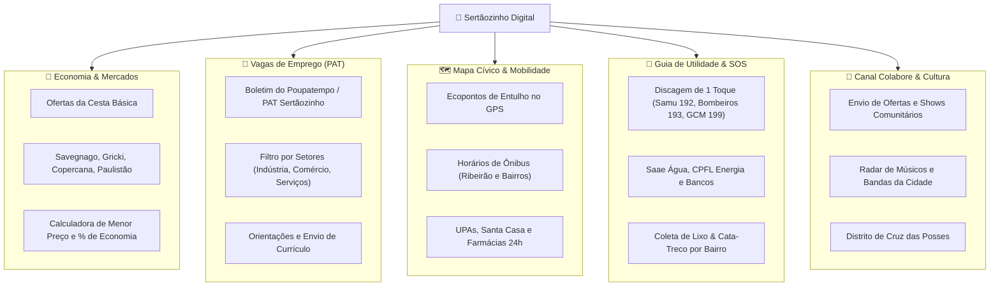

# 🌿 Sertãozinho Digital

> **Portal Cívico Vivo & Guia de Utilidade Pública de Sertãozinho/SP**, com comparador de preços e ofertas de supermercados em tempo real, vagas de emprego do PAT, mapa interativo de Ecopontos e UPAs no GPS, discagem rápida de emergências (SOS), canal de colaboração comunitária, radar de notícias locais e catálogo de artistas e músicos independentes.

[](https://github.com/FelipeGardenghiDev/sertaozinho-digital/actions/workflows/ci.yml)
[](https://web.dev/progressive-web-apps/)
[](https://capacitorjs.com/)
[](https://www.typescriptlang.org/)
[](https://react.dev/)
[](https://tailwindcss.com/)
[](https://vitest.dev/)
[](LICENSE)

🌐 **Acesso Web (Produção):** [https://felipegardenghidev.github.io/sertaozinho-digital/](https://felipegardenghidev.github.io/sertaozinho-digital/)

---

## 🎯 Por que o Sertãozinho Digital?

Em cidades dinâmicas do interior paulista como **Sertãozinho/SP** (capital brasileira da tecnologia sucroenergética), as informações vitais para o cidadão encontram-se espalhadas:
* As ofertas de mercados estão em encartes de papel ou posts efêmeros em redes sociais;
* As vagas de emprego do PAT exigem garimpar PDFs institucionais;
* Telefones de emergência, plantão de água (Saae), farmácias de plantão e serviços essenciais não possuem um canal unificado e rápido;
* Músicos, bandas locais e eventos culturais disputam espaço contra algoritmos fechados;
* Moradores têm dúvidas sobre onde descartar entulhos nos Ecopontos e os dias de Cata-Treco nos bairros.

O **Sertãozinho Digital** centraliza tudo isso em uma **Progressive Web App (PWA) ultrarrápida, gratuita, open-source e com custo de hospedagem R$ 0,00**, que pode ser instalada diretamente no celular ou empacotada como APK nativo Android via Capacitor.

---

## 🏛️ Funcionalidades Principais



---

## ⚡ Engenharia de Dados & Custo R$ 0,00

O projeto adota a arquitetura **Jamstack / Flat-File no Git**:
1. **Zero Banco de Dados SQL:** Os dados são estruturados em arquivos JSON versionados em `src/data/` (`mercados.json`, `vagas-pat.json`, `telefones-uteis.json`, `noticias.json`, `artistas.json`, `onibus.json`, `coleta-lixo.json`, `pontos-interesse.json`).
2. **Atualização Automatizada via Scraper Real & GitHub Actions:** Rotinas cron periódicas (`sync-data.yml`) coletam notícias diretamente do portal oficial da prefeitura (`sertaozinho.sp.gov.br`) e atualizam o repositório automaticamente.
3. **Imunidade a Quedas e Ataques:** A entrega é feita como site estático servido via CDN global (GitHub Pages), blindada contra ataques DDoS e sem custos com servidores.

---

## 📱 Compilação do APK Android Nativo

O **Sertãozinho Digital** adota a **mesma arquitetura móvel oficial do BodyMonitor e da Suíte Garden**, utilizando **Capacitor Android**:

- **No GitHub Actions:** A esteira `.github/workflows/ci.yml` compila automaticamente o arquivo `sertaozinho-digital-debug.apk` e disponibiliza o artefato para download direto na aba Actions.
- **Localmente:**
```bash
# 1. Compilar os assets web e sincronizar com o projeto nativo Android
npm run mobile:sync

# 2. Abrir o projeto no Android Studio para rodar em dispositivo físico
npm run mobile:open
```

---

## 🛠️ Stack Tecnológica

* **Linguagem:** TypeScript ~6.0
* **Framework:** React 19 + Vite 8
* **Estilização:** Tailwind CSS v4
* **Ícones:** Lucide React
* **PWA & Offline:** `vite-plugin-pwa` + Workbox Service Worker
* **Camada Nativa Mobile:** Capacitor 8 (`@capacitor/android` + `@capacitor/local-notifications`)
* **Testes & Qualidade:** Vitest 5 (17 testes automatizados) + Oxlint

---

## 💻 Como Rodar Localmente

```bash
# 1. Instalar as dependências
npm install

# 2. Executar a suíte de testes unitários (17 testes)
npm test

# 3. Validar linting
npm run lint

# 4. Rodar o scraper real da Prefeitura
npm run scrape

# 5. Iniciar o servidor local de desenvolvimento
npm run dev
```

---

## 📄 Licença
Distribuído sob a licença [MIT](LICENSE). Desenvolvido por **Felipe Gardenghi** para a comunidade de Sertãozinho/SP.
