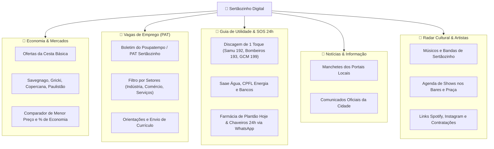

# 🌿 Sertãozinho Digital

> **Portal Cívico Vivo & Guia de Utilidade Pública de Sertãozinho/SP**, com comparador de preços e ofertas de supermercados em tempo real, vagas de emprego do PAT, discagem rápida de emergências (SOS), radar de notícias locais e catálogo de artistas e músicos independentes.

[](https://github.com/FelipeGardenghiDev/sertaozinho-digital/actions/workflows/ci.yml)
[](https://web.dev/progressive-web-apps/)
[](https://www.typescriptlang.org/)
[](https://react.dev/)
[](https://tailwindcss.com/)
[](LICENSE)

🌐 **Acesso Web (Produção):** [https://felipegardenghidev.github.io/sertaozinho-digital/](https://felipegardenghidev.github.io/sertaozinho-digital/)

---

## 🎯 Por que o Sertãozinho Digital?

Em cidades dinâmicas do interior paulista como **Sertãozinho/SP** (capital brasileira da tecnologia sucroenergética), as informações vitais para o cidadão encontram-se espalhadas:
* As ofertas de mercados estão em encartes de papel ou posts efêmeros em redes sociais;
* As vagas de emprego do PAT exigem garimpar PDFs institucionais;
* Telefones de emergência, plantão de água (Saae), farmácias de plantão e serviços essenciais não possuem um canal unificado e rápido;
* Músicos, bandas locais e eventos culturais disputam espaço contra algoritmos fechados.

O **Sertãozinho Digital** centraliza tudo isso em uma **Progressive Web App (PWA) ultrarrápida, gratuita, open-source e com custo de hospedagem R$ 0,00**, que pode ser instalada diretamente no celular ou empacotada como APK para a Google Play Store.

---

## 🏛️ Funcionalidades Principais



---

## ⚡ Engenharia de Dados & Custo R$ 0,00

O projeto adota a arquitetura **Jamstack / Flat-File no Git**:
1. **Zero Banco de Dados SQL:** Os dados são estruturados em arquivos JSON versionados em `src/data/` (`mercados.json`, `vagas-pat.json`, `telefones-uteis.json`, `noticias.json`, `artistas.json`).
2. **Atualização Automatizada via GitHub Actions:** Rotinas cron periódicas raspam e sincronizam os dados públicos sem necessidade de servidores backend dedicados.
3. **Imunidade a Quedas e Ataques:** A entrega é feita como site estático servido via CDN global (GitHub Pages / Cloudflare Pages), blindada contra ataques DDoS e sem vulnerabilidades de injeção de SQL.

---

## 📱 Como Gerar o APK para Android (Padrão Garden Apps & Capacitor)

O **Sertãozinho Digital** adota a **mesma arquitetura móvel oficial dos outros sistemas Garden (`garden-sfx-lab`, `garden-cut`, `garden-subtitle`)**, utilizando **Capacitor Android**:

```bash
# 1. Compilar os assets web e sincronizar com o projeto nativo Android
npm run mobile:sync

# 2. Abrir o projeto no Android Studio para rodar em emulador ou dispositivo físico
npm run mobile:open

# 3. Ou compilar diretamente o APK de teste via linha de comando:
cd android
./gradlew assembleDebug
# O APK gerado estará em: android/app/build/outputs/apk/debug/app-debug.apk
```

---

## 📄 O que é o `.webmanifest`?

O arquivo `.webmanifest` (ou `manifest.webmanifest` / `manifest.json`) é a **"carteira de identidade"** de um site para os navegadores e smartphones:

* **Sem o webmanifest:** Se você tentar "adicionar à tela inicial" no Chrome, ele apenas cria um atalho de favorito comum, abrindo o navegador com a barra de endereços visível e sem identidade própria.
* **Com o webmanifest:** O Android e o iOS reconhecem o site como uma **Progressive Web App (PWA)** real:
  1. **`name` / `short_name`:** Define o nome do aplicativo na gaveta de apps (ex: *"Stz Digital"*).
  2. **`icons`:** Especifica os ícones de alta resolução e com máscara adaptativa (*maskable*) para o app.
  3. **`display: "standalone"`:** Remove a barra de navegação do Chrome, fazendo o site abrir em **tela cheia** como se tivesse sido instalado pela Play Store.
  4. **`theme_color` e `background_color`:** Pinta a barra de status do topo do celular e exibe a tela de abertura (*splash screen*) na cor esmeralda do projeto.
  5. **`start_url`:** Garante que o aplicativo sempre abra na página inicial limpa.

---

## 🛠️ Stack Tecnológica

* **Linguagem:** TypeScript ~6.0
* **Framework:** React 19 + Vite 8
* **Estilização:** Tailwind CSS v4
* **Ícones:** Lucide React
* **PWA & Offline:** `vite-plugin-pwa` + Workbox Service Worker
* **Testes & Qualidade:** Vitest 5 + Oxlint

---

## 💻 Como Rodar Localmente

### Pré-requisitos
* **Node.js** (v20 ou v22 LTS recomendada)
* **npm**

### Passo a Passo
```bash
# Clone o repositório
git clone https://github.com/FelipeGardenghiDev/sertaozinho-digital.git

# Acesse o diretório
cd sertaozinho-digital

# Instale as dependências
npm install

# Inicie o servidor local de desenvolvimento
npm run dev
```

Abra seu navegador em `http://localhost:5173`.

### Comandos de Teste e Build
```bash
# Executar a suíte de testes unitários
npm run test

# Checar linting ultrarrápido
npm run lint

# Gerar build otimizada de produção
npm run build
```

---

## 📄 Licença
Distribuído sob a licença [MIT](LICENSE). Desenvolvido por **Felipe Gardenghi** para a comunidade de Sertãozinho/SP.
